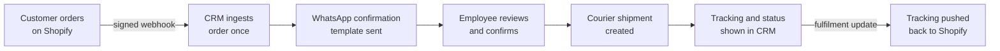
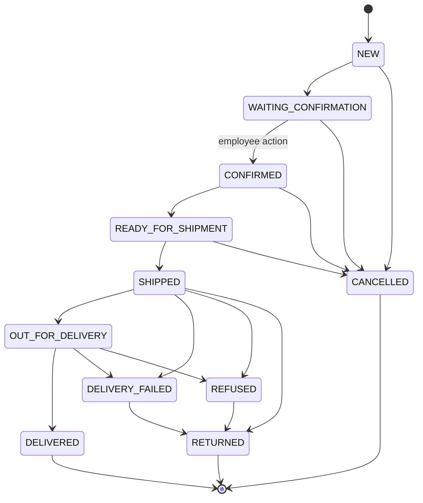
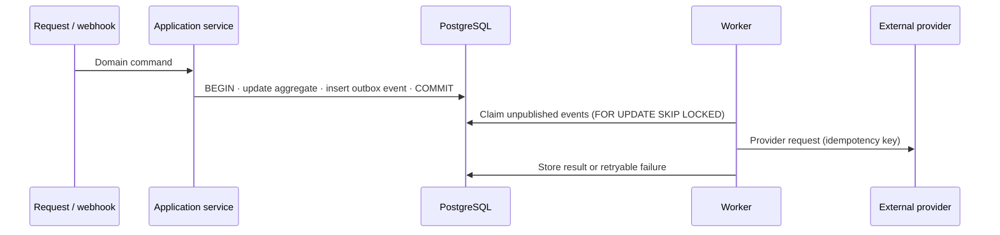
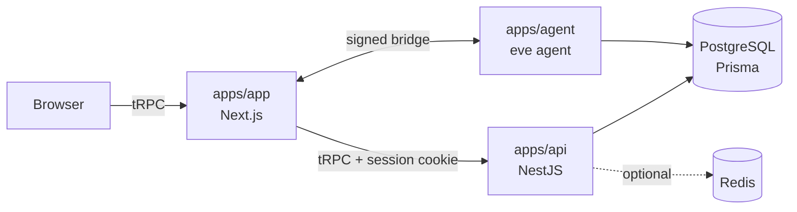

<h1 align="center">Commerce Operations CRM</h1>

<p align="center">
  <strong>A self-hosted operational CRM for e-commerce teams.</strong><br>
  Shopify orders, WhatsApp confirmations and courier shipments — managed from one place.
</p>

<p align="center">
  
  
  
  
  
  
</p>

---

## Table of contents

1. [Overview](#1-overview)
2. [Project status](#2-project-status)
3. [How it works](#3-how-it-works)
4. [Repository structure](#4-repository-structure)
5. [Architecture](#5-architecture)
6. [Integrations](#6-integrations)
7. [Tech stack](#7-tech-stack)
8. [Getting started](#8-getting-started)
9. [Configuration](#9-configuration)
10. [Development commands](#10-development-commands)
11. [Roadmap](#11-roadmap)
12. [Documentation](#12-documentation)
13. [Engineering conventions](#13-engineering-conventions)
14. [Security](#14-security)
15. [License and attribution](#15-license-and-attribution)

---

## 1. Overview

E-commerce operations teams usually juggle Shopify Admin, courier portals, spreadsheets
and WhatsApp to move one order from *placed* to *delivered*. **Commerce Operations CRM**
replaces that with a single workflow application.

| | |
| --- | --- |
| **Who it is for** | Operations employees who confirm, ship and track e-commerce orders |
| **Deployment model** | Self-hosted, one client installation, one organization |
| **Commercial model** | One-time licence |
| **Relationship to Shopify** | Independent application — not embedded in Shopify Admin |

### Source-of-truth model

| Owned by **Shopify** | Owned by the **CRM** |
| --- | --- |
| Storefront, checkout and order facts | Operational order workflow and status |
| Financial and fulfilment status | Employee decisions (confirmation, cancellation) |
| Products, variants, locations, inventory | WhatsApp messaging orchestration |
| | Courier coordination and tracking visibility |
| | Synchronization health and audit history |

### Core product rules

- The CRM **never double-deducts stock** — Shopify stays the inventory authority.
- A courier shipment is created **only after an employee confirms the order**.
- Courier, financial, fulfilment and message statuses are stored **separately** from the CRM operational status.
- Webhooks, jobs, provider calls and shipment creation are **idempotent**.
- Provider failures are **visible and retryable**.
- Credentials and personal data **never reach the frontend or the logs**.

---

## 2. Project status

> [!IMPORTANT]
> The project is in its **foundation phase**. The product specification is complete; the
> codebase is a fork that will be adapted to that specification.

| Area | State |
| --- | --- |
| Product and architecture specification ([`docs/`](./docs)) | ✅ Complete |
| Application foundation ([`crm/`](./crm)) | ✅ Imported — fork of the open-source [Comp AI CRM](https://github.com/trycompai/crm) |
| Commerce domain (orders, catalog, inventory, shipments, messages) | ⏳ Not started |
| Shopify integration | ⏳ Not started — `CRM Connector` dev app exists on a test store |
| WhatsApp Business Cloud API | ⛔ Blocked — Meta credentials and approved templates needed |
| Ozone Express courier | ⛔ Blocked — official API documentation and test credentials needed |

The imported foundation is a working B2B sales CRM (companies, contacts, deals, an AI
research agent). It provides the monorepo, authentication, database, UI kit and tooling.
The commerce domain described in `docs/` is built on top of it, milestone by milestone
(see [Roadmap](#11-roadmap)).

---

## 3. How it works

### End-to-end MVP workflow



### Order lifecycle

The CRM operational status is independent of Shopify and courier statuses.



`WAITING_CONFIRMATION → CONFIRMED` is always a human action. Courier-driven transitions
happen only through a reviewed mapping of raw courier statuses.

### Roles

| Role | Responsibilities |
| --- | --- |
| **Administrator** | Configure integrations, manage users, inspect all data, retry safe failures |
| **Operator** | View orders, catalog and inventory; confirm orders; permission-checked consequential actions |

---

## 4. Repository structure

```text
.
├── README.md                  ← you are here
├── docs/                      Product & architecture specification (Commerce Operations CRM)
│   ├── PRD.md                   Product requirements, scope, state machine
│   ├── ARCHITECTURE.md          System design, patterns, deployment
│   ├── DATABASE_DESIGN.md       Target data model
│   ├── INTEGRATIONS.md          Shopify, WhatsApp, courier contracts
│   ├── SECURITY.md              Threat model and controls
│   ├── IMPLEMENTATION_PLAN.md   Milestones and gates
│   └── MVP_ACCEPTANCE.md        Acceptance test cases
│
└── crm/                       Application monorepo (Turborepo + Bun)
    ├── apps/
    │   ├── app/                 Next.js web front end            · :3000
    │   ├── api/                 NestJS API — HTTP, auth, tRPC    · :3001
    │   └── agent/               eve-based AI agent (durable)     · :2000
    ├── packages/
    │   ├── db/                  Prisma schema, migrations, client
    │   ├── auth/                Better Auth configuration
    │   ├── ui/                  shadcn/ui components and theme
    │   ├── validation/          Shared Zod schemas
    │   ├── env/                 Root .env loader
    │   ├── telemetry/           Install telemetry (opt-out)
    │   └── typescript-config/   Shared tsconfig presets
    ├── docs/                    Technical docs for the foundation codebase
    ├── adrs/                    Architecture decision records
    ├── tools/                   Custom lint rules
    └── docker-compose.yml       Local PostgreSQL
```

---

## 5. Architecture

### 5.1 Target architecture

The target system is a **TypeScript modular monolith** — one repository, one release,
three process types. It is intentionally **not** a microservice architecture.

```mermaid
flowchart LR
    User[Operations employee] -->|HTTPS| Web[Next.js web]
    Web -->|secure session| API[NestJS API]

    Shopify[Shopify Admin API] -->|signed webhooks| API
    WhatsApp[WhatsApp Cloud API] -->|verified webhooks| API

    API --> PG[(PostgreSQL)]
    API --> Redis[(Redis)]
    Worker[NestJS worker] --> PG
    Worker --> Redis

    Worker -->|Admin API| Shopify
    Worker -->|Cloud API| WhatsApp
    Worker -->|Courier API| Courier[Ozone Express /<br/>Fake courier]
```



| Process | Responsibility |
| --- | --- |
| **web** | Screens, forms, accessibility, API client |
| **api** | Authentication, authorization, domain use cases, webhook ingress, OpenAPI |
| **worker** | Background jobs, outbox dispatch, synchronization, reconciliation, provider calls |

**PostgreSQL is the transactional authority.** Redis supports queues, rate limiting and
short-lived cache only — it never holds business truth.

### 5.2 Reliability patterns

| Pattern | What it guarantees |
| --- | --- |
| **Transactional outbox** | Every external side effect is written in the same transaction as the domain change, then dispatched asynchronously |
| **Durable webhook inbox** | Webhooks are signature-verified on the raw body, stored once by provider event ID, acknowledged fast and processed in the background |
| **Layered idempotency** | Unique keys at the inbox, external-ID mapping, command, outbox, queue and shipment levels prevent duplicate effects |
| **Optimistic concurrency** | Versioned aggregates reject stale writes with a clear conflict error |
| **Provider ports and adapters** | Domain code depends on `CommerceProvider`, `MessagingProvider` and `CourierProvider` interfaces — never on a vendor SDK |
| **Reconciliation** | Scheduled jobs repair missed webhooks and resolve ambiguous provider results |



Full details: [`docs/ARCHITECTURE.md`](./docs/ARCHITECTURE.md).

### 5.3 Current foundation

The code in [`crm/`](./crm) is a Turborepo monorepo inherited from Comp AI CRM.



- **Type-safe end to end** — the front end calls the API over tRPC; the router type is
  generated from the NestJS routers.
- **URL-driven list state** — filters, sorting and pagination live in the URL (nuqs).
- **One shared UI kit** — `packages/ui` is the only source of components.
- **One `.env` at the repo root**, read by every process.

### 5.4 From foundation to target

The foundation and the target specification differ in several places. Each difference
is resolved as part of the milestone that touches it.

| Concern | Foundation (today) | Target (specification) |
| --- | --- | --- |
| Domain | B2B sales — companies, contacts, deals | Commerce — orders, customers, catalog, inventory, shipments, messages |
| API style | tRPC | REST `/api/v1` with OpenAPI, plus `/webhooks/v1/{provider}` |
| Background work | eve agent schedules and task queue | NestJS worker with BullMQ and a transactional outbox |
| Authentication | Better Auth with Google / Microsoft SSO | Email and password (Argon2id), server-side sessions |
| Authorization | Sign-in allow-list | Fixed `ADMIN` / `OPERATOR` roles, organization-scoped |
| AI agent | Core feature | Out of MVP scope |
| Package manager / runtime | Bun 1.3, Node 24 | Decided in Milestone 0 |

---

## 6. Integrations

| Provider | Purpose | MVP status |
| --- | --- | --- |
| **Shopify** (GraphQL Admin API `2026-07`) | Orders, customers, products, inventory, fulfilment | Planned — client-credentials grant, token renewed every 24 h |
| **WhatsApp Business Cloud API** | Approved order-confirmation templates, delivery status | Gated on Meta credentials and templates |
| **Ozone Express** | Shipment creation, tracking, status sync | Gated on official documentation and test credentials |
| **FakeCourierProvider** | Simulated courier for development and demos | Planned — always labelled as simulated |

> [!WARNING]
> Ozone Express endpoints, authentication, payloads and statuses must **never** be
> guessed. Until official documentation exists, only the fake courier is allowed.

Future providers (post-MVP): **YouCan**, **WooCommerce** (commerce) and **Vitex**,
**Ameex** (courier). The provider interfaces already account for them.

Full contracts: [`docs/INTEGRATIONS.md`](./docs/INTEGRATIONS.md).

---

## 7. Tech stack

| Layer | Technology |
| --- | --- |
| Language | TypeScript everywhere |
| Monorepo | Turborepo |
| Web | Next.js (App Router), React, Tailwind CSS, shadcn/ui |
| Forms and validation | React Hook Form, Zod |
| API | NestJS |
| Database | PostgreSQL with Prisma |
| Queue and cache | Redis (BullMQ in the target worker) |
| Logging | Structured JSON with redaction (Pino in the target) |
| Lint and format | Biome, oxlint, knip |
| Local infrastructure | Docker Compose |

---

## 8. Getting started

### Prerequisites

- [Node.js 24 LTS](https://nodejs.org/en/download)
- [Bun 1.3.12](https://bun.com)
- [Docker](https://www.docker.com/)

### Run locally

```sh
cd crm
cp .env.example .env          # fill in the required values (see Configuration)
bun install

docker compose up -d          # PostgreSQL on :5432
bun run db:deploy             # apply migrations
bun run db:seed               # optional demo data
bun run dev                   # start every app in watch mode
```

| Service | URL |
| --- | --- |
| Web app | <http://localhost:3000> |
| API | <http://localhost:3001> |

Detailed setup (OAuth clients, database commands, secrets): [`crm/docs/setup.md`](./crm/docs/setup.md).

---

## 9. Configuration

All configuration lives in **one `.env` file at the root of `crm/`**. Real environment
variables always take precedence. [`crm/.env.example`](./crm/.env.example) documents
every variable.

### Required today

| Variable | Description |
| --- | --- |
| `DATABASE_URL` | PostgreSQL connection — the default matches `docker compose` |
| `BETTER_AUTH_SECRET` | Session signing secret — generate with `openssl rand -base64 32` |
| `ALLOWED_SIGN_IN` | Allowed email domains or addresses, e.g. `acme.com,you@gmail.com` |
| `GOOGLE_CLIENT_ID` / `GOOGLE_CLIENT_SECRET` | Google OAuth client (or use Microsoft below) |
| `MICROSOFT_CLIENT_ID` / `MICROSOFT_CLIENT_SECRET` | Microsoft Entra app registration (optional alternative) |

### Commerce integrations (planned)

```env
SHOPIFY_SHOP_DOMAIN=
SHOPIFY_CLIENT_ID=
SHOPIFY_CLIENT_SECRET=
SHOPIFY_API_VERSION=2026-07
```

WhatsApp and Ozone variables are added when their readiness gates pass. Secrets stay
server-side and are never exposed through `NEXT_PUBLIC_*` variables.

---

## 10. Development commands

Run from `crm/`.

| Command | Description |
| --- | --- |
| `bun run dev` | Prepare the local database and run all apps in watch mode |
| `bun run build` | Build all apps and packages |
| `bun run test` | Run the test suite |
| `bun run check-types` | Type-check every workspace |
| `bun run lint` / `bun run format` | Lint and format with Biome |
| `bun run lint:slop` / `bun run lint:dead` | oxlint rules / dead-code detection with knip |
| `bun run db:migrate` | Create and apply a migration |
| `bun run db:deploy` | Apply pending migrations |
| `bun run db:seed` | Seed demo data (idempotent) |
| `bun run db:studio` | Open Prisma Studio |

Scope any command to one workspace with a Turborepo filter, e.g. `bun run dev --filter=api`.

---

## 11. Roadmap

| Milestone | Scope | Status |
| --- | --- | --- |
| **0 — Foundation** | Monorepo, web / API / worker shells, PostgreSQL + Redis, first migration, config validation, admin bootstrap, login and sessions, `ADMIN`/`OPERATOR` roles, health checks, logging, CI | 🔄 In progress |
| **1 — Shopify slice** | Token lifecycle, initial import, order and inventory webhooks, durable inbox, reconciliation, order APIs | ⏳ Planned |
| **2 — Operations dashboard** | Orders list and detail, timeline, read-only catalog and inventory, confirmation, failed jobs, user management | ⏳ Planned |
| **3 — WhatsApp** | Approved confirmation template, idempotent message intents, status webhooks, authorized resend | ⛔ Gated |
| **4 — Ozone** | Official-contract courier adapter, shipment creation, tracking, Shopify fulfilment update | ⛔ Gated |
| **5 — MVP verification** | End-to-end and duplicate-safety tests, production Docker setup, backup procedure, client UAT | ⏳ Planned |

### Release levels

| Level | Composition |
| --- | --- |
| **Technical demonstration** | Live Shopify + live WhatsApp + `FakeCourierProvider` (labelled simulated) |
| **Client MVP** | Live Shopify + live WhatsApp + live Ozone Express |

### Out of MVP scope

YouCan, WooCommerce, Vitex and Ameex adapters · inbound WhatsApp conversations · AI
support · multi-tenant SaaS and billing · catalog editing · CRM-managed stock · custom
roles · advanced analytics · native mobile apps.

Full plan: [`docs/IMPLEMENTATION_PLAN.md`](./docs/IMPLEMENTATION_PLAN.md).

---

## 12. Documentation

### Product specification — [`docs/`](./docs)

Recommended reading order:

| # | Document | Contents |
| --- | --- | --- |
| 1 | [PRD](./docs/PRD.md) | Vision, scope, roles, state machine, functional requirements |
| 2 | [Architecture](./docs/ARCHITECTURE.md) | System context, modules, outbox, webhooks, deployment |
| 3 | [Integrations](./docs/INTEGRATIONS.md) | Provider contracts, Shopify, WhatsApp, courier workflows |
| 4 | [Database design](./docs/DATABASE_DESIGN.md) | Target tables, constraints, tenant safety, retention |
| 5 | [Security](./docs/SECURITY.md) | Threat model, auth, secrets, privacy, hardening |
| 6 | [Implementation plan](./docs/IMPLEMENTATION_PLAN.md) | Milestones, gates, definition of done |
| 7 | [MVP acceptance](./docs/MVP_ACCEPTANCE.md) | Acceptance cases and sign-off |

### Foundation codebase — [`crm/docs/`](./crm/docs)

| Document | Contents |
| --- | --- |
| [setup.md](./crm/docs/setup.md) | Local setup, OAuth clients, database commands |
| [environment.md](./crm/docs/environment.md) | Every environment variable and why it exists |
| [api.md](./crm/docs/api.md) | API rules — tRPC, auth, logging, sync, caching |
| [design.md](./crm/docs/design.md) | UI system and component rules |
| [agent.md](./crm/docs/agent.md) | The eve agent — tools, tasks, dispatch |
| [CONTRIBUTING.md](./crm/CONTRIBUTING.md) | Workflow, CI, versioning, releases |

---

## 13. Engineering conventions

The full rule set lives in [`crm/AGENTS.md`](./crm/AGENTS.md). The essentials:

- **Read the area's doc before changing it** — see the index in `crm/AGENTS.md`.
- **One `.env` at the root.** Document every new variable in `.env.example`.
- **Optional integrations never throw.** A missing key removes a capability; it does not crash the app.
- **`packages/ui` is the only source of UI.** New variants go there, not at the call site.
- **Parse untrusted data at the boundary** with Zod; never pass `Record<string, unknown>` around.
- **Server pages compute, client components render.** Client code never imports `@crm/db` or `@crm/auth`.
- **Tunable constants live in one config module per area.**
- **No external API call inside a database transaction.**

---

## 14. Security

- Secrets and access tokens stay server-side and are never logged or sent to the browser.
- Webhooks are verified on the raw request body before any processing.
- Logs redact credentials, cookies, signatures and personal data.
- Authorization is enforced by the API, never by hidden UI alone.

Threat model and controls: [`docs/SECURITY.md`](./docs/SECURITY.md).
Report vulnerabilities privately as described in [`crm/SECURITY.md`](./crm/SECURITY.md).

---

## 15. License and attribution

The application foundation is forked from [**Comp AI CRM**](https://github.com/trycompai/crm),
released under the [MIT License](./crm/LICENSE) — © 2026 Comp AI. The upstream project's
original README is kept at [`crm/README.md`](./crm/README.md).
