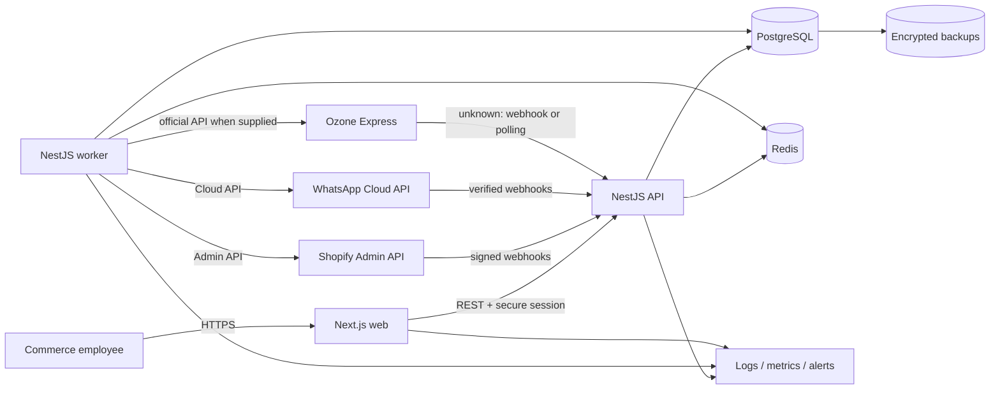
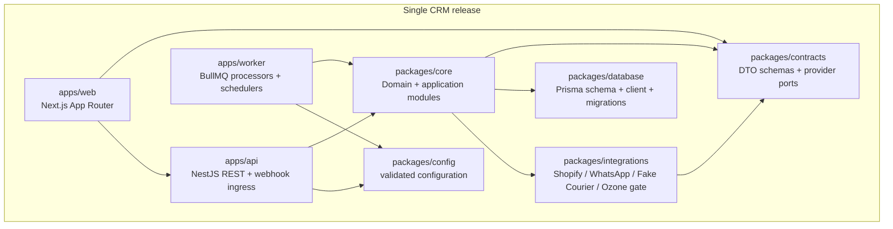
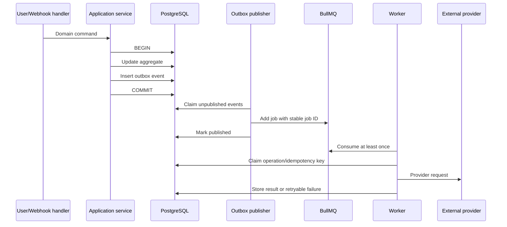
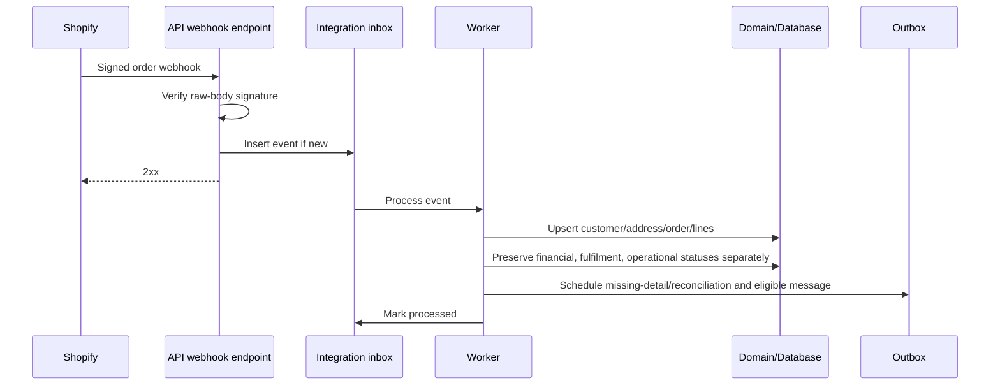
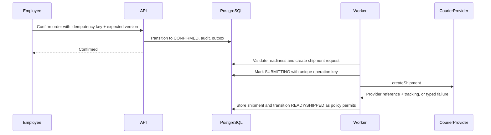

# Commerce Operations CRM — Architecture

## 1. Architectural goals

The system is a TypeScript modular monolith with three independently runnable process types:

- `web`: Next.js App Router browser application and server-side web layer.
- `api`: NestJS REST API, authentication, webhook ingestion, domain use cases, and OpenAPI.
- `worker`: NestJS application context hosting BullMQ consumers, outbox dispatch, synchronization, reconciliation, and external calls.

All processes are released from one repository and one version. This is not a microservice architecture. PostgreSQL is the transactional authority; Redis supports queues, distributed coordination, rate limiting, and short-lived cache only.

## 2. System context



Ozone's inbound arrow is conceptual only. The official documentation must determine whether status ingestion uses webhooks, polling, or both.

## 3. Container view



`packages/core` is added to the suggested structure because both API and worker require the same domain rules without importing one deployable app from another. It remains part of the modular monolith.

## 4. Repository structure

```text
apps/
  web/
  api/
  worker/

packages/
  core/
  database/
  contracts/
  integrations/
  config/
  eslint-config/
  typescript-config/

docs/
```

Responsibilities:

- `apps/web`: route layouts, screens, forms, query hooks, accessibility, and generated API client use.
- `apps/api`: controllers, guards, validation, OpenAPI, webhook transport handling, composition root.
- `apps/worker`: queue processors, schedules, outbox poller/dispatcher, worker composition root.
- `packages/core`: domain entities/policies and application services grouped by module; no Next.js or provider SDK imports.
- `packages/database`: Prisma schema, migrations, transaction helper, seed/bootstrap, database test utilities.
- `packages/contracts`: API DTOs, Zod schemas where shared, provider ports, normalized enums, error types.
- `packages/integrations`: adapters and provider-specific DTO mapping; raw SDK/HTTP details do not escape.
- `packages/config`: environment schema, typed configuration, secret references, process-specific validation.

## 5. Module boundaries

| Module | Owns | May call |
|---|---|---|
| Authentication | Credentials, session lifecycle, sign-in throttling | Users, Audit |
| Users and roles | Users, memberships, roles, permissions | Audit |
| Organizations | Organization settings and bootstrap | Audit |
| Dashboard | Read models and aggregate queries | Orders, Shipments, Sync |
| Orders | Order mirror, line snapshots, CRM status machine, confirmation | Customers, Catalog read ports, Messages, Shipments, Outbox, Audit |
| Customers | Customer mirror and addresses | Integration mapping, Audit |
| Products | Product and variant mirror | Integration mapping |
| Inventory | Locations and inventory-level mirror | Products, Integration mapping |
| Shipments | Shipment request lifecycle, normalized courier events | Orders, Courier port, Outbox, Audit |
| Messages | Message lifecycle, template selection | Orders, Customers, Messaging port, Outbox |
| Shopify integration | Shopify mapping, import, webhook translation, outbound fulfilment | Commerce provider port and owning domain modules |
| WhatsApp integration | Template/message adapter and webhook translation | Messaging provider port, Messages |
| Courier integrations | Courier mapping and callbacks/polling | Courier provider port, Shipments |
| Webhooks | Signature verification, durable inbox, fast response | Integration event store, queues |
| Background jobs | Dispatch, scheduling, retry policy, dead-letter handling | Application services |
| Synchronization | Sync runs, cursors, reconciliation | Provider adapters and owning modules |
| Audit logs | Append-only user/system activity | No domain mutation |
| Health checks | Liveness/readiness and dependency probes | Infrastructure only |

Rules:

1. Controllers and processors call application services; they do not contain business rules.
2. A module writes only its owned tables, except through an explicit application service.
3. Provider SDK models are mapped at adapter boundaries.
4. Domain code depends on provider contracts, never concrete Shopify, WhatsApp, or courier adapters.
5. Cross-module side effects are represented by domain/outbox events where atomic direct calls are inappropriate.
6. No external API call is held inside a PostgreSQL transaction.

## 6. Provider ports

The full contracts are specified in `INTEGRATIONS.md`. At architecture level:

```ts
interface CommerceProvider {
  verifyWebhook(input: WebhookVerificationInput): Promise<VerifiedWebhook>;
  pullProducts(input: PullPageInput): Promise<PullPage<ExternalProduct>>;
  pullLocations(input: PullPageInput): Promise<PullPage<ExternalLocation>>;
  pullInventory(input: PullInventoryInput): Promise<PullPage<ExternalInventoryLevel>>;
  pullCustomers(input: PullPageInput): Promise<PullPage<ExternalCustomer>>;
  pullOrders(input: PullPageInput): Promise<PullPage<ExternalOrder>>;
  getOrder(input: GetExternalResourceInput): Promise<ExternalOrder>;
  upsertFulfilmentTracking(input: FulfilmentTrackingInput): Promise<ExternalFulfilmentResult>;
  healthCheck(): Promise<ProviderHealth>;
}

interface MessagingProvider {
  verifyWebhook(input: WebhookVerificationInput): Promise<VerifiedWebhook>;
  sendTemplate(input: SendTemplateInput): Promise<SendMessageResult>;
  healthCheck(): Promise<ProviderHealth>;
}

interface CourierProvider {
  capabilities(): CourierCapabilities;
  createShipment(input: CreateShipmentInput): Promise<CreateShipmentResult>;
  getShipment(input: GetShipmentInput): Promise<ExternalShipment>;
  cancelShipment(input: CancelShipmentInput): Promise<CancelShipmentResult>;
  verifyWebhook(input: WebhookVerificationInput): Promise<VerifiedWebhook>;
  healthCheck(): Promise<ProviderHealth>;
}
```

Unsupported capabilities return a typed `CapabilityNotSupported` result. The live Ozone implementation cannot fill these methods until official behavior is known.

## 7. Core execution patterns

### 7.1 Commands and reads

- REST mutation reaches an authenticated controller.
- Guard resolves organization and permissions.
- DTO validation rejects malformed input.
- Application service loads organization-scoped state and checks invariants.
- One database transaction applies state and appends audit/outbox records.
- API returns accepted/current state; external completion occurs asynchronously.
- Read endpoints use bounded, indexed queries and cursor pagination for large event tables.

### 7.2 Transactional outbox

Every action requiring an external effect writes an `outbox_event` in the same PostgreSQL transaction as the domain change.



Publishing is at-least-once. Stable BullMQ job IDs reduce duplicates but are not the correctness boundary. Consumer-side database uniqueness and state checks provide correctness.

Outbox fields include `id`, `organization_id`, `aggregate_type`, `aggregate_id`, `event_type`, `payload_json`, `schema_version`, `idempotency_key`, `correlation_id`, `occurred_at`, `available_at`, `published_at`, `attempt_count`, `last_error_code`, and claim/lock timestamps.

Workers claim records with PostgreSQL row locking using `FOR UPDATE SKIP LOCKED` semantics. A stale claim can be reclaimed. Retention/archival policy is configurable after successful dispatch.

### 7.3 Durable webhook inbox

Webhook ingress follows:

1. Read the raw request bytes under a strict size limit.
2. Verify provider signature before JSON transformation.
3. Extract provider event ID, topic/type, account/shop identity, and correlation metadata.
4. Insert an `integration_event` with a unique provider-connection/event-ID constraint.
5. Return success for an already-known valid event.
6. Enqueue processing after durable insert and respond quickly.
7. Worker parses and applies an idempotent upsert in a transaction.
8. Mark processed, retryable failure, or terminal failure with sanitized diagnostics.

Invalid signatures are rejected and rate-limited. Their bodies are not stored as trusted events.

### 7.4 Idempotency layers

| Layer | Key/guard | Purpose |
|---|---|---|
| Webhook inbox | `(connection_id, external_event_id)` | Deduplicate provider delivery |
| External mapping | `(connection_id, resource_type, external_id)` | One local resource per provider resource |
| Domain command | `(organization_id, command_type, idempotency_key)` | Replayed client/job command returns prior result |
| Outbox | Unique `idempotency_key` | One intended side effect |
| Queue | Stable job ID | Reduce repeat dispatch |
| Provider operation | Stable client reference when provider supports it | Provider-side dedupe |
| Aggregate state/version | Optimistic version and transition rules | Prevent invalid repeats/races |
| Shipment | Unique active primary request per order | Prevent ordinary duplicate creation |

Idempotency does not solve an ambiguous provider timeout if the provider has neither idempotency keys nor lookup by client reference. Such an Ozone operation must become `RECONCILIATION_REQUIRED`, stop automatic creation retries, and require lookup/manual resolution based on official capabilities.

## 8. Principal workflows

### 8.1 Shopify order ingestion



The webhook is a change signal. If payload completeness or freshness is insufficient, the worker fetches the authoritative order through `CommerceProvider.getOrder` before applying. Exact Shopify topics and payload guarantees are validated against the pinned API version.

### 8.2 Order confirmation and shipment



Order confirmation and courier submission are deliberately separate. A worker validates address, phone, lines, integration readiness, and provider requirements before marking `READY_FOR_SHIPMENT`.

### 8.3 WhatsApp template message

An eligible imported order transaction creates one message intent and outbox event. The worker validates normalized phone, consent/configuration, template mapping and locale, then calls `MessagingProvider.sendTemplate`. Provider message ID and subsequent verified status events update the message; message failure never rolls back order import.

### 8.4 Shopify fulfilment update

When shipment tracking is valid and the configured policy permits:

1. Shipment transaction creates a Shopify fulfilment outbox event.
2. Worker loads required Shopify fulfilment references.
3. Adapter creates or updates tracking using the supported Shopify API operation.
4. Result is mapped to the order's Shopify fulfilment state without changing CRM operational status implicitly.
5. Retryable failures retry; validation/permission failures become visible terminal failures.

Exact fulfilment-order scopes, ownership, line allocation, and notification settings are an integration readiness gate.

## 9. Consistency and concurrency

- PostgreSQL transactions are the domain consistency boundary.
- Mutable aggregates have an integer `version`; mutations use expected-version checks.
- Money is integer minor units plus currency.
- External raw payloads are stored only where necessary, encrypted or minimized, access-restricted, size-limited, and retention-controlled.
- Worker claims use leases and compare-and-set state changes.
- Queue delivery is assumed at-least-once.
- Read-your-write is provided by PostgreSQL primary reads; caches cannot be authoritative.
- Scheduled reconciliation repairs missed webhooks and compares source update timestamps/cursors.
- External API calls occur after commit, never while holding domain locks.

## 10. API architecture

- Base path: `/api/v1`.
- JSON REST with generated OpenAPI; webhook endpoints are separate under `/webhooks/v1/{provider}`.
- Cookie-authenticated browser requests require CSRF protection for unsafe methods.
- Mutating endpoints accept `Idempotency-Key` where replay is plausible and `If-Match`/version where concurrency matters.
- Errors use a stable envelope containing `code`, `message`, `correlationId`, and field errors; no stack/provider secret is returned.
- List endpoints use bounded page size; high-volume timelines/events use cursor pagination.
- OpenAPI excludes secret configuration values and documents required permissions.

Representative module routes:

```text
/api/v1/auth
/api/v1/users
/api/v1/roles
/api/v1/dashboard
/api/v1/orders
/api/v1/customers
/api/v1/products
/api/v1/inventory
/api/v1/shipments
/api/v1/messages
/api/v1/integrations
/api/v1/sync-runs
/api/v1/integration-events
/api/v1/failed-jobs
/api/v1/audit-logs
/health/live
/health/ready
/webhooks/v1/shopify
/webhooks/v1/whatsapp
/webhooks/v1/courier
```

These route groups define ownership, not a frozen endpoint-by-endpoint API contract.

## 11. Configuration and secrets

Configuration is validated at process startup. Categories:

- Public operational configuration: organization name/time zone, feature flags, non-secret provider identifiers.
- Secrets: database URL, Redis credentials, session signing/pepper keys, field-encryption key, Shopify secret/token, Meta app secret/token, webhook verification values, future Ozone credentials.
- Runtime settings: ports, log level, worker concurrency, retry policies, API versions, data limits.

Secrets are supplied through environment variables or mounted secret files for the initial self-hosted deployment. Provider settings screens display presence, suffix/fingerprint, last validation, and rotation state, never the value. Production secrets must not be compiled into Next.js public variables or images.

## 12. Deployment topology

Minimum production topology:

```text
TLS reverse proxy / load balancer
  ├─ web container
  └─ api container

worker container
PostgreSQL with persistent encrypted volume/backups
Redis with authentication and persistence appropriate to queue recovery
central log/metric destination
```

- Images are immutable and versioned by release/commit.
- Database migration runs as a controlled one-shot release task before app rollout.
- API/web can be horizontally replicated after shared session, rate-limit, and webhook behavior are validated.
- Worker concurrency is explicitly configured per queue/provider.
- Redis loss may require re-publishing unpublished/unfinished work from PostgreSQL; it must not erase committed business intent.
- Development Docker Compose includes PostgreSQL, Redis, web, API, and worker; fake provider is allowed only outside live mode.

## 13. Observability

Pino emits structured JSON with:

- timestamp, level, service/process, release version;
- correlation, request, job, outbox, integration event, and organization IDs;
- provider and operation name;
- duration, result class, retry count, and safe error code.

Logs redact authorization headers, cookies, tokens, passwords, webhook secrets/signatures, phone/email/address fields, and raw bodies. Metrics cover HTTP, webhook verification/lag, queue depth/age, outbox lag, job outcomes, provider latency/error class, sync freshness, and database pool saturation. Alerts target sustained queue lag, readiness failure, repeated authentication attacks, backup failure, synchronization staleness, and terminal integration failures.

## 14. Architectural decisions

| Decision | Rationale | Consequence |
|---|---|---|
| Modular monolith | One team/product and tightly coupled transactions | Enforce module boundaries in code/tests |
| PostgreSQL authority | Strong constraints and atomic outbox | Redis is never business truth |
| Async external effects | Provider latency/failure isolation | UI shows pending states |
| Provider ports/adapters | Future YouCan/WooCommerce/couriers | Normalized contracts must avoid least-common-denominator leakage |
| Organization ID from day one | Future tenancy migration path | Every repository method requires organization context |
| Separate statuses | Prevent destructive conflation | UI/data model carry four status dimensions |
| Fake courier until Ozone contract | Honest, testable development | Live acceptance remains gated |
| Opaque server-side sessions | Revocation and reduced token exposure | Session storage/cleanup required |

## 15. Architectural risks

- Ambiguous Ozone create-shipment results can cause duplicates without provider idempotency or reference lookup.
- Shopify fulfilment APIs and scopes may not match the existing app configuration.
- Bulk initial sync can exceed rate limits or time windows without cursor/checkpoint design.
- Webhook ordering is not guaranteed; stale events must not overwrite newer source versions.
- Automatic WhatsApp messages may violate consent/template/locale expectations if business policy is not approved.
- Organization scoping can be missed in ad hoc queries unless repositories and tests enforce it.
- Storing diagnostic payloads can leak PII; minimization and retention are required.
- Single-host deployment creates an availability boundary; documented backup/restore is mandatory.

Mitigations and ownership are expanded in `IMPLEMENTATION_PLAN.md` and `SECURITY.md`.
