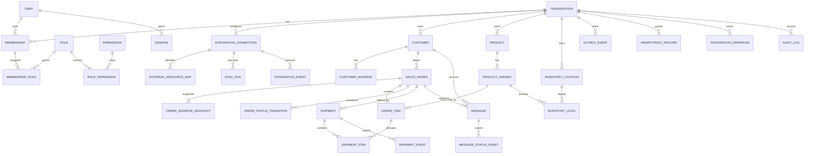

# Commerce Operations CRM — Database Design

## 1. Design principles

- PostgreSQL is the authoritative transactional store.
- Prisma owns schema declarations and migrations; production schema changes are migration-reviewed.
- Every organization-owned row contains `organization_id`, including data in the single-client MVP.
- External identities are unique within an integration connection, not globally.
- Shopify financial status, Shopify fulfilment status, CRM operational status, and courier status use separate fields/tables.
- Domain state and its outbox/audit effects commit atomically.
- External payloads are minimized; frequently queried facts use typed columns.
- Primary keys are application-generated UUIDs. External identifiers remain strings because providers may exceed numeric ranges or change formats.
- Timestamps are `timestamptz` in UTC. Mutable rows have `created_at`, `updated_at`, and an integer `version` where optimistic concurrency is required.
- Monetary values are integer minor units with an ISO 4217 currency code.
- Customer data is classified and access-restricted as defined in `SECURITY.md`.

## 2. Relationship overview



## 3. Identity, organization, and access

### 3.1 `organization`

| Column | Notes |
|---|---|
| `id` | UUID primary key |
| `slug` | Unique normalized installation-local slug |
| `name` | Display name |
| `time_zone` | IANA time zone |
| `default_locale` | BCP 47 locale |
| `status` | `ACTIVE`, `SUSPENDED` |
| timestamps/version | Standard mutable metadata |

There is one row in MVP. Code must not assume a fixed ID.

### 3.2 `user`

| Column | Notes |
|---|---|
| `id` | UUID primary key |
| `email_normalized` | Unique normalized sign-in identifier |
| `display_name` | Employee display name |
| `password_hash` | Argon2id encoded hash |
| `status` | `ACTIVE`, `DISABLED` |
| `password_changed_at` | Invalidates older sessions by policy |
| `last_login_at` | Nullable operational metadata |
| timestamps/version | Standard metadata |

Authentication identity is global, while access to an organization is through membership. This supports a future user belonging to more than one organization without implementing tenant switching now.

### 3.3 `membership`

- `id`, `organization_id`, `user_id`, `status`, timestamps.
- Unique `(organization_id, user_id)`.
- Status: `ACTIVE`, `DISABLED`.

### 3.4 `role`, `permission`, `membership_role`, `role_permission`

- `role`: organization-scoped role with unique `(organization_id, name_normalized)`, display name, description, `is_system_template`. MVP seeds exactly `ADMIN` and `OPERATOR`.
- `permission`: application-defined permission key and description; globally unique key.
- `membership_role`: unique `(membership_id, role_id)`.
- `role_permission`: unique `(role_id, permission_id)`.
- Database/application validation ensures membership and role belong to the same organization.

The schema may retain permission rows for forward compatibility, but MVP authorization exposes only the fixed role policy. Administrators cannot create custom roles or edit permission mappings until post-MVP.

Initial permission families:

```text
dashboard.read
orders.read
orders.confirm
orders.cancel
customers.read
catalog.read
inventory.read
shipments.read
shipments.create
shipments.retry
messages.read
messages.send
messages.retry
integrations.read
integrations.manage
sync.run
jobs.read
jobs.retry
users.manage
audit.read
```

### 3.5 `session`

| Column | Notes |
|---|---|
| `id` | UUID primary key and non-secret selector |
| `user_id` | Session owner |
| `token_hash` | Hash of the opaque cookie secret; never store raw token |
| `created_at`, `last_seen_at`, `expires_at` | Lifecycle |
| `revoked_at`, `revoke_reason` | Revocation |
| `ip_hash`, `user_agent_summary` | Optional minimized security telemetry |

Indexes support token lookup, active sessions by user, and expiry cleanup.

## 4. Integrations and external identity

### 4.1 `integration_connection`

Represents one configured provider account/shop/phone/courier account.

| Column | Notes |
|---|---|
| `id`, `organization_id` | Identity and scope |
| `category` | `COMMERCE`, `MESSAGING`, `COURIER` |
| `provider_key` | `SHOPIFY`, `WHATSAPP_CLOUD`, `FAKE_COURIER`, future `OZONE` |
| `display_name` | User-facing connection name |
| `external_account_id` | Shop domain/account identifier where non-secret |
| `status` | `DRAFT`, `ACTIVE`, `DEGRADED`, `DISABLED`, `BLOCKED` |
| `config_encrypted` | Only configuration that cannot be represented safely in typed non-secret fields |
| `secret_reference` | Optional reference to external secret storage; no secret in UI |
| `last_health_check_at`, `last_health_status`, `last_error_code` | Safe health summary |
| timestamps/version | Standard metadata |

Unique connection rules are installation policy. The MVP allows one active connection for each category, enforced by application logic and a PostgreSQL partial unique index where practical.

### 4.2 `external_resource_map`

Decouples provider identity from domain tables.

| Column | Notes |
|---|---|
| `id`, `organization_id`, `connection_id` | Scope |
| `resource_type` | `ORDER`, `CUSTOMER`, `PRODUCT`, `VARIANT`, `LOCATION`, `INVENTORY_ITEM`, `FULFILMENT_ORDER`, `FULFILMENT`, `SHIPMENT`, `MESSAGE` |
| `external_id` | Provider identifier as string |
| `local_entity_type`, `local_entity_id` | Mapped domain identity |
| `external_updated_at` | Source update timestamp if supplied |
| `external_version` | Source version if supplied |
| `last_seen_at` | Reconciliation metadata |

Constraints:

- Unique `(connection_id, resource_type, external_id)`.
- Unique `(connection_id, resource_type, local_entity_type, local_entity_id)` when the mapping is one-to-one.
- Index `(organization_id, local_entity_type, local_entity_id)`.

### 4.3 `sync_run`

- `id`, `organization_id`, `connection_id`.
- `resource_type`, `mode` (`INITIAL`, `INCREMENTAL`, `RECONCILIATION`, `MANUAL`).
- `status` (`QUEUED`, `RUNNING`, `SUCCEEDED`, `PARTIAL`, `FAILED`, `CANCELLED`).
- Opaque `cursor_encrypted` or non-sensitive cursor, `high_water_mark`.
- Counts: scanned, created, updated, unchanged, failed.
- `started_at`, `heartbeat_at`, `finished_at`, `last_error_code`, sanitized `last_error_message`.
- Only one active run per connection/resource/mode class where overlap is unsafe.

### 4.4 `integration_event` — durable inbox

| Column | Notes |
|---|---|
| `id`, `organization_id`, `connection_id` | Scope |
| `provider_key`, `event_type`, `external_event_id` | Dedupe and routing |
| `external_occurred_at`, `received_at` | Source and ingress times |
| `signature_key_version` | Which secret/version verified the event, not the secret |
| `payload_encrypted` | Optional minimized raw payload with retention |
| `payload_hash` | Diagnostics/integrity |
| `status` | `RECEIVED`, `PROCESSING`, `PROCESSED`, `RETRYABLE_FAILURE`, `TERMINAL_FAILURE`, `IGNORED` |
| `attempt_count`, `available_at`, `processed_at` | Processing |
| `correlation_id`, error fields | Trace and safe diagnosis |

Unique `(connection_id, external_event_id)`. If a provider lacks a stable event ID, the adapter must define and document a conservative composite/fingerprint strategy before production.

## 5. Commerce domain

### 5.1 `customer`

- `id`, `organization_id`.
- `email_encrypted`, `email_search_hash`.
- `phone_e164_encrypted`, `phone_search_hash`, `phone_last4`.
- `first_name_encrypted`, `last_name_encrypted`.
- `accepts_marketing` only if needed and supplied; it is not equivalent to WhatsApp consent.
- `source_created_at`, `source_updated_at`, timestamps/version.
- No global uniqueness on phone/email; source identity is enforced by external mapping.

### 5.2 `customer_address`

- `id`, `organization_id`, `customer_id`.
- Type/default flags.
- Encrypted recipient, company, address lines, city, region, postal code, phone.
- Country code in clear for routing/report grouping when approved.
- `source_updated_at`, timestamps.

Addresses are synchronized contact records. Orders use immutable snapshots.

### 5.3 `sales_order`

| Column | Notes |
|---|---|
| `id`, `organization_id`, `customer_id` | Identity; customer nullable if source permits |
| `source_name`, `source_number` | Human-facing Shopify values |
| `crm_operational_status` | Required CRM state enum |
| `commerce_financial_status` | Provider-normalized/raw-supported value, separate |
| `commerce_fulfilment_status` | Provider-normalized/raw-supported value, separate |
| `source_cancelled_at`, `source_closed_at` | Source facts |
| `confirmed_at`, `confirmed_by_user_id` | CRM confirmation |
| `currency_code` | ISO currency |
| amount minor fields | Subtotal, discount, shipping, tax, total, outstanding where supplied |
| `customer_note` | Nullable, minimized operational note; per-field customer-data encryption is post-MVP |
| `source_created_at`, `source_updated_at` | Ordering/staleness protection |
| `imported_at`, `last_synced_at` | CRM freshness |
| timestamps/version | Mutable aggregate metadata |

Indexes:

- `(organization_id, crm_operational_status, source_created_at DESC)`.
- `(organization_id, source_created_at DESC, id)`.
- `(organization_id, commerce_financial_status)`.
- `(organization_id, commerce_fulfilment_status)`.
- Search support for source order name/number using a normalized column/index.

### 5.4 `order_address_snapshot`

- `id`, `organization_id`, `order_id`, `kind` (`SHIPPING`, `BILLING`).
- Encrypted recipient/contact/address fields.
- Country code and normalized routing fields where approved.
- Unique `(order_id, kind)`.

Snapshots change only when a newer Shopify order update changes the order's authoritative address and no local shipment has frozen the dispatch snapshot. Any post-shipment discrepancy is recorded for manual review.

### 5.5 `order_item`

- `id`, `organization_id`, `order_id`, nullable `variant_id`.
- External line identity is mapped or unique within order.
- Snapshot: title, variant title, SKU, quantity, fulfilled quantity, requires shipping, taxable.
- Unit price, discount, tax, and line total in minor units.
- Optional `source_inventory_item_id` mapping reference.
- Index `(order_id)` and `(organization_id, variant_id)`.

### 5.6 `order_status_transition`

- `id`, `organization_id`, `order_id`.
- `from_status`, `to_status`.
- `trigger_type` (`USER`, `SHOPIFY_EVENT`, `COURIER_EVENT`, `SYSTEM`).
- Nullable actor user and provider event reference.
- `reason_code`, sanitized note, `correlation_id`, `occurred_at`.

This is the operational timeline authority; `sales_order.crm_operational_status` is the current projection.

## 6. Catalog and inventory

### 6.1 `product`

- `id`, `organization_id`, title, handle, vendor, product type.
- `source_status`, `source_created_at`, `source_updated_at`, `last_synced_at`.
- Timestamps/version and external mapping.

### 6.2 `product_variant`

- `id`, `organization_id`, `product_id`.
- Title, SKU, barcode, option summary.
- Price and compare-at price minor units plus currency where present.
- `tracks_inventory`, `source_status`, source timestamps, `last_synced_at`.
- Indexes on `(organization_id, sku)` and `(product_id)`. SKU is searchable but not assumed unique.

### 6.3 `inventory_location`

- `id`, `organization_id`, name, source status/address summary, source timestamps, last sync.
- External mapping supplies Shopify location identity.

### 6.4 `inventory_level`

- `id`, `organization_id`, `variant_id`, `location_id`.
- `available_quantity` and additional named quantities only when supported and required.
- `source_updated_at`, `last_synced_at`, timestamps/version.
- Unique `(variant_id, location_id)`.
- Index `(organization_id, location_id)`.

Inventory levels are a mirror. No order confirmation or shipment transition decrements this table directly.

## 7. Shipment domain

### 7.1 `shipment`

| Column | Notes |
|---|---|
| `id`, `organization_id`, `order_id`, `courier_connection_id` | Scope and relationship |
| `shipment_number` | CRM human reference |
| `kind` | MVP `PRIMARY`; future split/return values reserved only when implemented |
| `request_status` | `DRAFT`, `READY`, `SUBMITTING`, `CREATED`, `RETRYABLE_FAILURE`, `TERMINAL_FAILURE`, `RECONCILIATION_REQUIRED`, `CANCELLED` |
| `normalized_courier_status` | `UNKNOWN`, `CREATED`, `IN_TRANSIT`, `OUT_FOR_DELIVERY`, `DELIVERED`, `FAILED`, `REFUSED`, `RETURNED`, `CANCELLED` |
| `raw_courier_status` | Provider value, nullable |
| `provider_shipment_id`, `tracking_number`, `tracking_url` | Filled only from provider result |
| `client_reference` | Stable CRM reference sent if provider supports it |
| `shipping_address_snapshot_encrypted` | Exact dispatch data minimized/encrypted |
| `submitted_at`, `created_at_provider`, `last_status_at`, `delivered_at` | Lifecycle |
| `last_error_code`, `last_error_message` | Sanitized |
| timestamps/version | Standard metadata |

MVP application invariant: one active `PRIMARY` shipment request per order. Enforce with a partial unique index for statuses that can lead to or represent a live shipment. Multiple rows remain possible for explicitly cancelled/terminal attempts only under a controlled retry/recreate workflow.

### 7.2 `shipment_item`

- `id`, `organization_id`, `shipment_id`, `order_item_id`, `quantity`.
- Unique `(shipment_id, order_item_id)`.
- Quantity must be positive and cannot exceed the accepted shippable allocation.

### 7.3 `shipment_event`

- `id`, `organization_id`, `shipment_id`.
- Provider event identity or stable fingerprint.
- `raw_status`, `normalized_status`, event time, received time.
- Location/description only if required and privacy-approved.
- `payload_encrypted` only when required for support and under retention.
- `integration_event_id`, `correlation_id`.
- Unique provider event identity per shipment when available.

Events are append-only. Out-of-order events remain stored; projection logic uses source event time, precedence rules, and manual exception handling.

## 8. Messaging domain

### 8.1 `message`

- `id`, `organization_id`, nullable `order_id`, nullable `customer_id`, `messaging_connection_id`.
- `channel` (`WHATSAPP`), `direction` (`OUTBOUND` in MVP).
- `purpose` (`ORDER_CONFIRMATION`, `SHIPMENT_CREATED`, `OUT_FOR_DELIVERY`, `DELIVERED`, or configured approved subset).
- `template_name`, `template_locale`, encrypted/minimized parameter snapshot.
- Encrypted recipient phone and searchable hash/last four.
- `status` (`QUEUED`, `SUBMITTING`, `SUBMITTED`, `SENT`, `DELIVERED`, `READ`, `FAILED`, `SKIPPED`).
- `provider_message_id`, `submitted_at`, status timestamps.
- `idempotency_key`, failure fields, timestamps/version.
- Unique `(organization_id, idempotency_key)`.

### 8.2 `message_status_event`

- `id`, `organization_id`, `message_id`.
- Provider event ID/fingerprint, provider message ID.
- Raw and normalized status, source time, received time.
- Safe error code/details, integration event reference.
- Unique provider event identity when available.

Status projection is monotonic where the provider lifecycle is ordered; late lower-precedence events are retained without regressing the current projection.

## 9. Reliability, operations, and audit

### 9.1 `outbox_event`

Defined in `ARCHITECTURE.md`. Important constraints/indexes:

- Unique `(organization_id, idempotency_key)`.
- Index `(published_at, available_at, occurred_at)` for publisher scans.
- Index on stale claim expiry.
- Payload has an explicit `schema_version`.

### 9.2 `idempotency_record`

- `id`, `organization_id`, `scope`, `idempotency_key`.
- Request fingerprint, operation/aggregate identity.
- `status` (`IN_PROGRESS`, `COMPLETED`, `FAILED_RETRYABLE`, `FAILED_FINAL`).
- Stored safe response code/body reference for deterministic replay.
- `locked_until`, `expires_at`, timestamps.
- Unique `(organization_id, scope, idempotency_key)`.

The same key with a different request fingerprint is a conflict.

### 9.3 `integration_operation`

Provides durable user-facing state for outbound work and jobs:

- `id`, `organization_id`, connection, operation type, target entity.
- Stable idempotency key/client reference.
- `status` (`PENDING`, `RUNNING`, `SUCCEEDED`, `RETRYABLE_FAILURE`, `TERMINAL_FAILURE`, `RECONCILIATION_REQUIRED`).
- Attempt count, next attempt, provider reference, safe request fingerprint/result summary, errors, timestamps.
- Unique `(connection_id, operation_type, idempotency_key)`.

BullMQ is transport and scheduling; this table is the durable operational record shown in the UI.

### 9.4 `audit_log`

- `id`, `organization_id`.
- Actor type (`USER`, `SYSTEM`, `PROVIDER`), nullable user ID.
- Action, target type/ID, outcome.
- Request/correlation ID, source IP hash, user-agent summary.
- Sanitized encrypted/minimized metadata and before/after changed-field summary.
- `occurred_at`.

No update/delete path is exposed to application users. Index organization/time, actor/time, and target/time. Long-term tamper-evidence or archive signing is a post-MVP hardening option, not an MVP claim.

## 10. Tenant-safety conventions

1. Repository methods require an `OrganizationContext`; no optional organization filter.
2. Composite relations include organization identity where Prisma/database support makes cross-organization linkage impossible.
3. Transactions verify related entity organization IDs.
4. Unique business keys include `organization_id` unless intentionally global.
5. Authorization tests attempt cross-organization IDs even though production MVP provisions one organization.
6. PostgreSQL row-level security is not required for the single-tenant MVP; if future shared-database SaaS is implemented, RLS is evaluated as defense in depth.

This is architectural preparation, not a claim that MVP is production multi-tenant.

## 11. Deletion, retention, and archival

- Domain records referenced by orders, shipments, audit, or integration history use restricted deletion and status/anonymization policies rather than cascaded hard deletion.
- Sessions and expired idempotency records are periodically purged.
- Raw/minimized webhook and provider payload retention is short and configurable.
- Audit, order, shipment, customer, and message retention requires client/legal approval before production.
- Shopify mandatory deletion/redaction requests must be mapped to an approved anonymization workflow.
- Backup retention must be consistent with deletion commitments; immediate removal from immutable backups is not promised unless the backup design supports it.

## 12. Migration and data quality rules

- Migrations are forward-reviewed, deterministic, and run once per release.
- Destructive schema changes require backup, compatibility plan, and rollback/roll-forward procedure.
- Large data backfills use resumable jobs rather than long blocking migrations.
- Seed data creates permissions and default roles; bootstrap creates the one organization/admin through a separate secure command.
- Database checks enforce positive quantities, valid minor-unit ranges, and allowed enums where practical.
- Normalization functions for email, phone, and source identifiers are versioned and test-covered.

## 13. Index and query review checklist

Before each module is accepted:

- Every foreign key has an index when used for lookup.
- List screens have composite indexes matching organization, filters, and sort.
- Event/timeline queries use cursor pagination by `(occurred_at, id)`.
- Search is limited to MVP fields and avoids unbounded PII scans; per-field encryption/search indexes are post-MVP unless a later release gate requires them.
- No unbounded `findMany` or N+1 relationship loading.
- `EXPLAIN ANALYZE` is captured for critical list queries at the reference dataset.
- Outbox, inbox, session, idempotency, and integration-operation cleanup queries are indexed.

## 14. Open database decisions

- Whether and how to add per-field customer-data encryption before broader commercial deployment.
- Approved fields and retention for raw Shopify/Meta payloads.
- Whether exact-name/customer search is required; privacy-preserving search limitations must be accepted.
- Expected production volume and required reporting history.
- Whether one order can have multiple delivery attempts in MVP.
- Ozone identifiers, status values, reference uniqueness, and reconciliation fields after official documentation review.
